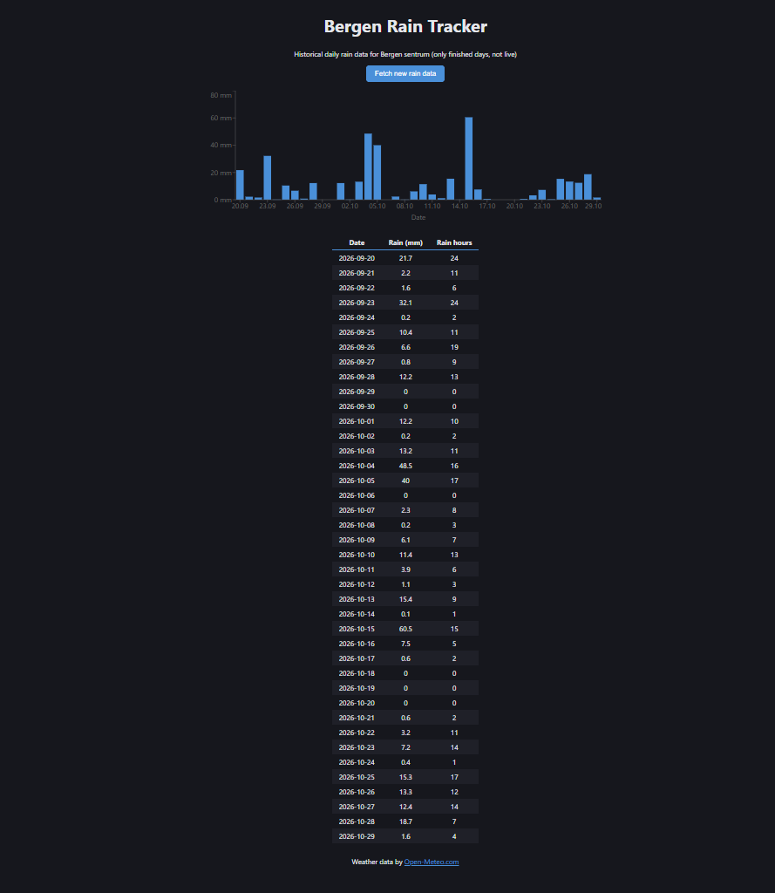

# Bergen Rain Tracker

A rain history app for Bergen, built with an ASP.NET Core REST API, PostgreSQL in Docker, and a React frontend.

## Features

- A button fetches daily rain data for Bergen sentrum from Open-Meteo and saves it in PostgreSQL
- History grows over time (old days are kept, no duplicate dates)
- React frontend with a bar chart (rain in mm per day, hover a bar for details) and a table (all values, including rain hours)
- REST API built with ASP.NET Core (Swagger UI included)
- PostgreSQL runs in Docker (Docker Compose)

## How it works

React fetches from the API -> the API uses EF Core to read/write PostgreSQL -> JSON is sent back to React.

## How to run

1. Start Docker Desktop, then from the repo root run: `docker compose up -d`
2. Open `BergenRainTracker/BergenRainTracker.slnx` in Visual Studio
3. Apply the migrations: Package Manager Console (Default project: `BergenRainTracker.Api`) -> `Update-Database`
4. Run the API (F5 or the green Run button, https) - Swagger UI is at `https://localhost:7196/swagger`
5. Available endpoints:
	- `POST /api/rain/fetch` - fetches new finished days and saves them
	- `GET /api/rain` - returns all saved days
6. In a new terminal, from `BergenRainTracker/BergenRainTracker.Web`, run: `npm install`, then `npm run dev`
7. Open `http://localhost:5173`
8. The first time, the page is empty: press the "Fetch new rain data" button to save the last 31 finished days
9. When done: stop React (q + Enter) and the API, then run `docker compose down`

**Requirements:** Visual Studio with the .NET 10 SDK, Node.js, and Docker Desktop.

## About the data

- Historical daily rain, not live: Open-Meteo's "today" is only half a day and partly forecast, so only finished days are shown
- Model data for a small area around Bergen sentrum (60.39, 5.32), not all of Bergen
- Days are counted 00:00 to 00:00, while [Yr](https://www.yr.no/) uses a weather station and counts 07:00 to 07:00, so values can differ a bit

## Built with

C#, ASP.NET Core, EF Core, PostgreSQL, Docker, React (Vite), Recharts

Weather data by [Open-Meteo.com](https://open-meteo.com/) (CC BY 4.0)
 